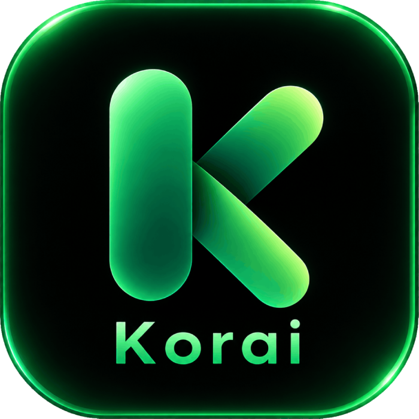
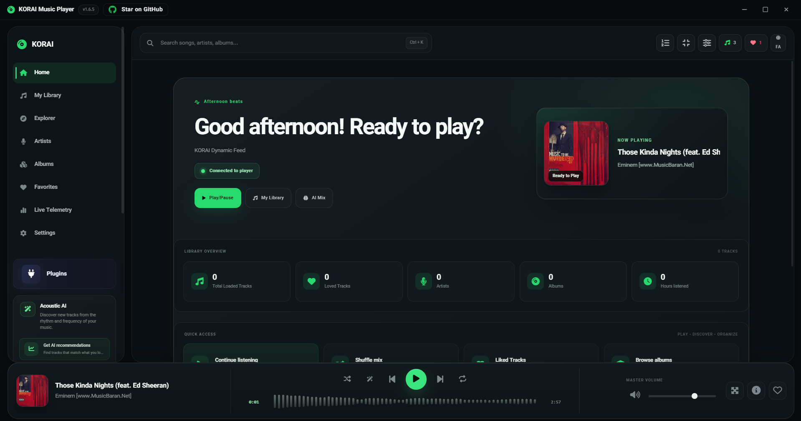
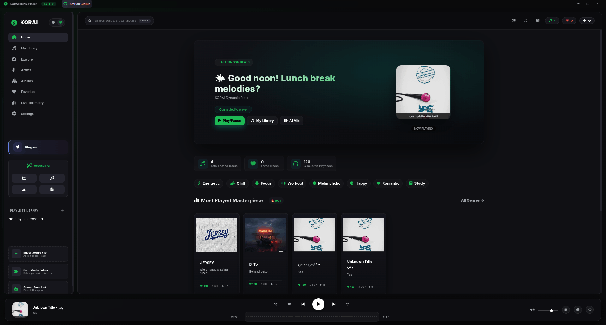
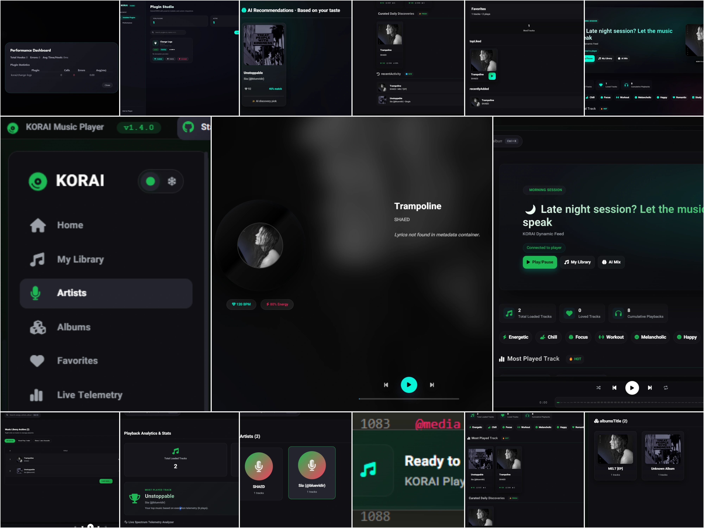
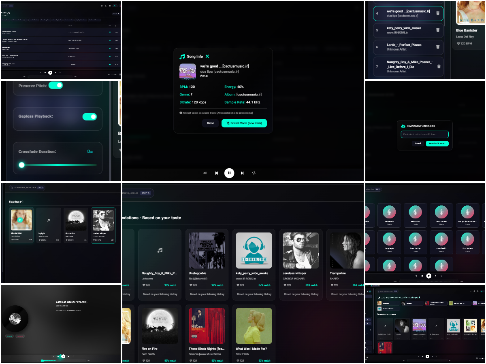

<div align="center">



# KORAI Player

### v1.7.0 · Local-first desktop music player

**A better way to enjoy the music you already own.**

KORAI is a desktop music player for building, organizing, and enjoying your own music library. It combines library management, playlists, audio analysis, sound customization, visualizations, recommendations, and plugin support in one application.

Listen to your own collection without needing an account or a subscription for core playback.

<p>
  <a href="https://github.com/Behdad-kanaani/korai-player/releases/latest"></a>
  <a href="https://github.com/Behdad-kanaani/korai-player/releases"></a>
  <a href="https://github.com/Behdad-kanaani/korai-player/stargazers"></a>
  <a href="LICENSE"></a>
</p>

<p>
  
  
  
</p>

<p>
  <a href="https://github.com/Behdad-kanaani/korai-player/releases/latest"><strong>Download KORAI</strong></a>
  &nbsp;·&nbsp;
  <a href="https://github.com/Behdad-kanaani/korai-player/issues"><strong>Report an issue</strong></a>
  &nbsp;·&nbsp;
  <a href="https://github.com/Behdad-kanaani/korai-player/discussions"><strong>Discussions</strong></a>
</p>

</div>

---

## About KORAI

Your music collection is more than a list of files. It includes albums you return to, playlists you have put together over time, and tracks you want to organize and listen to on your own terms.

KORAI gives that collection a dedicated home. Browse music by track, album, or artist; manage metadata and playlists; explore audio information; and adjust playback to suit your headphones, speakers, and preferences. The aim is to bring these everyday tasks together in one coherent desktop experience without making a streaming catalogue the center of the product.

KORAI is **local-first**. Core playback does not require an account or subscription, and the application is designed around music you already have. Optional online features are available separately when you choose to use them.

Version **1.7.0** adds a shared master audio engine, customizable sound profiles, device-specific profile switching, live DSP feedback, and improvements to playback behavior, file opening, persistence, and packaged builds.

## What's new in v1.7.0

### Audio engine and sound profiles

- **Shared `KoraiAudioEngine`:** A master audio bus brings playback processing into a common signal chain, with controls for preamp, low-cut, bass, treble, warmth, stereo width, crossfeed, reverb, compression, balance, limiter, and output.
- **11 built-in sound profiles:** Includes Reference, Bass Boost, Headphone Comfort, Room Speakers, Night Mode, Vocal Clarity, Concert Hall, Vinyl Warmth, Ultra Wide, Loud & Punchy, and Mono Focus.
- **Custom profile management:** Create, save, rename, duplicate, revert, and delete profiles. Up to 50 custom profiles can be stored, with JSON import and export for individual profiles and profile packs.
- **Profiles for output devices:** Assign a sound profile to an output device and switch automatically when the active device changes.
- **Live DSP feedback:** View peak levels, gain reduction, and a response curve. A/B bypass makes it easier to compare processed sound with the bypassed signal.
- **Graphic Studio presets:** Six EQ presets—Flat, Rock, Pop, Classical, Bass Boost, and Treble Boost—along with improved selection feedback and fewer unnecessary settings writes.

### Playback and application reliability

- More consistent queue handling for shuffle, next, previous, track movement, and empty queues.
- Improved behavior for manual track changes and Repeat One.
- Playback speed from **0.5× to 2×**, with tempo and pitch-preservation settings reapplied when tracks change.
- Expanded file-opening argument support for WMA, Opus, CUE, M3U, M3U8, and PLS, with improved checks to distinguish files from folders.
- Corrected plugin path resolution for packaged builds.
- Improved database flushing, settings persistence, shutdown behavior, and update installation lifecycle handling.
- Additional safeguards for HTML escaping, audio-recovery retries, paths, URLs, keys, and plugin-store routes.

These changes focus on making sound customization more capable while keeping everyday playback and the installed application more predictable.

---

## Features

### Music library

Keep your collection organized and easy to browse.

- Import music from individual files or folders.
- Browse tracks, albums, and artists.
- Search your library and manage favorites.
- Read and edit supported metadata, including multilingual text.
- Work with album artwork and CUE sheets.
- Open supported audio and playlist files directly with KORAI.
- Export library information to CSV.

### Playback and queue management

The player includes the controls needed for everyday listening, with queue behavior designed to remain consistent as tracks change.

- Play, pause, seek, and navigate between tracks.
- Shuffle and repeat modes.
- Queue reordering and removal.
- Gapless playback and configurable crossfade.
- Playback speed from 0.5× to 2×, with pitch preservation where supported.
- Playback resume, fullscreen, media keys, and tray or background behavior where supported.
- A compact mini-player for keeping playback accessible while using other parts of the application.

### Playlists

Create playlists for different moods, albums, activities, or listening sessions. KORAI supports importing and exporting common playlist formats so your organization is not limited to one view or workflow.

Supported formats include **M3U, M3U8, PLS, XSPF, ASX, WPL, and JSON**. Support for individual files can depend on the format and the contents of the playlist.

### Sound profiles and DSP

KORAI v1.7.0 introduces `KoraiAudioEngine`, a shared master audio bus that routes playback through a consistent processing chain.

The signal path is:

`Input → Preamp → Low-cut → Bass / Treble → Warmth → Stereo Width → Crossfeed → Reverb → Compressor → Balance → Limiter → Output`

Available controls include preamp, low-cut, bass, treble, warmth, stereo width, headphone crossfeed, reverb amount and character, compression, balance, mono mode, and limiting. The engine also includes a fallback connection path if the master bus cannot be reached.

The 11 built-in profiles offer starting points for different listening preferences:

| Profile | Intended use |
|---|---|
| Reference | A neutral starting point |
| Bass Boost | More low-frequency presence |
| Headphone Comfort | A gentler headphone presentation with crossfeed |
| Room Speakers | Speaker-oriented low-cut and stereo width |
| Night Mode | More controlled dynamics and reduced bass |
| Vocal Clarity | Greater vocal intelligibility |
| Concert Hall | A wider, more reverberant presentation |
| Vinyl Warmth | A warmer tonal character |
| Ultra Wide | Expanded stereo width with short reverb |
| Loud & Punchy | A more compressed, forward sound |
| Mono Focus | Mono listening with compression |

You can create and manage up to 50 custom profiles, import or export profiles as JSON, and associate profiles with output devices. Live peak and gain-reduction meters, a response curve, and A/B bypass help you understand and compare changes. The safety limiter remains active during bypass comparison.

Profiles are starting points rather than universal settings; the result depends on the track, playback equipment, and personal preference.

### Graphic Studio and visualization

Graphic Studio brings sound adjustment and visual feedback into a dedicated workspace.

- Five-band graphic equalizer.
- Six presets: Flat, Rock, Pop, Classical, Bass Boost, and Treble Boost.
- Real-time spectrum visualization.
- Waveform timeline.
- Response-curve feedback.
- Integrated controls for exploring and adjusting the sound.

### Audio analysis

KORAI can analyze available audio information to make the library more useful.

- BPM detection when a suitable tempo tag is unavailable.
- Audio-derived track features.
- Lightweight vocal extraction using an FFmpeg-based center-channel approach.

For BPM estimation, KORAI can decode a bounded mono preview through FFmpeg, build an onset envelope, and estimate tempo from the audio. It also accounts for common half-time and double-time ambiguity. Automatic tempo detection is not exact for every track, particularly recordings with unusual rhythms, live performances, or weak transients.

The vocal extraction feature uses stereo center-channel processing. It is **not an AI source-separation model**, and results vary with the mix and stereo arrangement of the recording.

### Recommendations

Recommendations can use signals available in the local library and listening activity, including listening history, likes and skips, genre and artist relationships, recency, BPM, content similarity, and playlist-flow heuristics.

This approach is intended to provide useful suggestions without requiring a large remote AI service for core local-library recommendations. The quality of results depends on the metadata and listening information available.

### Music Explorer

Music Explorer provides an optional route to online music discovery beyond the files already in your collection. Online discovery and remote catalog integrations may require network access; core local playback does not depend on them.

### Plugin system

KORAI includes a plugin architecture for extending the application without making every capability part of the core player.

The system includes plugin workers, manifest validation, permission handling, lifecycle management, performance monitoring, hot reload, command-line tooling, and a registry-based plugin catalog. The catalog supports validation, search, version comparison, caching, remote registry loading, and a local fallback.

In packaged builds, plugin paths are resolved through the appropriate packaged resources location rather than relying on paths inside the application archive. As with any extension system, plugins should be obtained from sources you trust.

### Settings and desktop integration

Settings bring together playback, audio, library scanning, recommendations, plugins, language, appearance, and performance options.

Depending on the operating system and build configuration, desktop integration can include file associations or direct file opening, media keys, tray and background behavior, fullscreen playback, playback resume, and compact playback modes.

### Updates

Supported packaged builds include an in-app workflow for checking and installing available releases. Update availability depends on the published release assets and build configuration. Version 1.7.0 also improves shutdown and close-to-tray handling to reduce interference with quitting or update installation.

---

## Privacy and local-first design

KORAI is built for people who want to manage their music without making a streaming account the center of the experience.

- Core local playback does not require an account.
- Core player use does not require a subscription.
- Your own music files remain the foundation of the library.
- Library data, playlists, favorites, listening history, settings, and recommendation signals are designed around local application data.
- Online discovery and remote plugin-catalog features are separate from essential local playback.

Some optional features use network access when enabled. Local-first does not mean every feature is offline, and users should review the behavior of any plugins or online integrations they choose to use.

The goal is straightforward: give you control over your collection and listening experience without making cloud access a prerequisite for playing music you already own.

---

## Interface and language

KORAI's interface is designed to keep the library and playback controls easy to understand without crowding every screen with information. The design direction emphasizes clearer hierarchy, consistent controls and surfaces, deliberate spacing, restrained motion, and a more focused home experience.

Persian and English are supported, with attention to right-to-left and left-to-right layouts.

- Bundled **Vazirmatn** typography.
- Persian UI and metadata support.
- RTL/LTR direction handling.
- Persian-aware search and presentation across supported views.

Persian support is treated as part of the product, not simply as a reversed text direction.

---

## Reliability and security

KORAI includes ongoing work on application boundaries and state handling, including:

- Centralized validation helpers for paths, URLs, and keys.
- Stronger HTML escaping for attribute contexts.
- Rate limiting on plugin-store routes.
- Validation for plugin and remote-resource boundaries.
- More reliable database flushing during shutdown.
- Improved handling of settings changes during active saves.
- Bounded audio-recovery retries.
- More consistent quit and install-update lifecycle handling.

These safeguards improve the application's handling of common failure cases, but they do not guarantee that software is free from bugs or security issues. Reproducible reports remain valuable.

---

## Screenshots

<table>
  <tr>
    <td align="center" width="50%">
      <strong>v1.7.0</strong><br><br>
      
    </td>
    <td align="center" width="50%">
      <strong>v1.5.0</strong><br><br>
      
    </td>
  </tr>
  <tr>
    <td align="center" width="50%">
      <strong>v1.4.0</strong><br><br>
      
    </td>
    <td align="center" width="50%">
      <strong>v1.3.0</strong><br><br>
      
    </td>
  </tr>
</table>

---

## How KORAI compares

Music players solve different problems. Streaming services prioritize access to hosted catalogues; simpler players often focus on opening and playing files. KORAI focuses on managing a personal collection and providing more control over how it sounds.

| Priority | KORAI Player | Streaming-first services | Basic folder players |
|---|---|---|---|
| Play music you already own | Core purpose | Often secondary to the hosted catalogue | Usually supported |
| Account required for local playback | No | Depends on the service | Usually not |
| Subscription required for core player use | No | Depends on the service and plan | Usually not |
| Library organization | Tracks, albums, artists, metadata, favorites, and playlists | Primarily service catalogue and playlists | Varies by application |
| Audio customization | Master DSP, sound profiles, EQ presets | Varies by service and device | Varies |
| Profiles mapped to output devices | Supported | Not typically a core feature | Uncommon |
| Local analysis and recommendations | Available | Often driven by the service | Varies |
| Plugin architecture | Included | Usually controlled by the platform | Varies |
| Persian and RTL support | Explicitly supported | Depends on the application | Depends on the application |
| Playback without a streaming service | Yes | Usually not the primary model | Yes |

KORAI is not intended to replace every reason to use a streaming service. Hosted catalogues are useful when you want access to music you do not own. KORAI serves a different purpose: giving your existing collection a capable home, with more control over organization and sound.

---

## Technology

KORAI is built with established tools and libraries, including:

- [Electron](https://www.electronjs.org/) — desktop application runtime
- [FFmpeg](https://ffmpeg.org/) — media decoding and audio processing
- [music-metadata](https://github.com/Borewit/music-metadata) — metadata parsing
- [Express](https://expressjs.com/) — local application services
- [Vazirmatn](https://github.com/rastikerdar/vazirmatn) — Persian typography
- [Ajv](https://ajv.js.org/) — schema validation
- [Chokidar](https://github.com/paulmillr/chokidar) — file-system watching
- [Sharp](https://sharp.pixelplumbing.com/) — image processing
- [semver](https://github.com/npm/node-semver) — version handling

## Download and installation

Download the latest release from GitHub:

**[Download KORAI Player](https://github.com/Behdad-kanaani/korai-player/releases/latest)**

Check the release notes for the available installer and platform-specific instructions.

## Development

### Requirements

- Node.js 20 LTS recommended
- npm 9 or newer

### Run locally

```bash
git clone https://github.com/Behdad-kanaani/korai-player.git
cd korai-player
npm install
npm start
```

### Run project checks

```bash
npm test
npm run audit:static
npm run check
npm run plugin
```

### Build for Windows

```bash
npm run dist:win
```

### Create a plugin

```bash
npm run plugin -- create my-plugin
```

See `package.json` for the complete list of available scripts and build targets.

## Project structure

```text
korai-player/
├── main.js
├── preload.js
├── package.json
├── src/
│   ├── backend/       # Analysis, library services, plugins, updates, persistence
│   └── frontend/      # Player UI, audio engine, DSP, settings, explorer
├── plugins/
│   └── registry.json
├── scripts/           # Auditing and developer tooling
├── screenshot/
├── korai.png
├── korai.ico
└── LICENSE
```

## Project direction

KORAI is an ongoing project. Its goal is not to add features simply to make a longer list. It is to keep improving the parts that matter when using a music player every day: a library that is easy to navigate, sound controls that are useful, playback that behaves predictably, and an interface that stays out of the way of the music.

Version 1.7.0 is an important step in that work, with its shared audio engine, customizable sound profiles, improved queue handling, and continued attention to packaged-app reliability.

## Contributing and feedback

Bug reports, feature ideas, reproducible issues, and technical feedback are welcome.

- [Open an issue](https://github.com/Behdad-kanaani/korai-player/issues)
- [Start a discussion](https://github.com/Behdad-kanaani/korai-player/discussions)
- [Browse releases](https://github.com/Behdad-kanaani/korai-player/releases)

When reporting a bug, include your KORAI version, operating system, steps to reproduce the issue, and relevant logs or screenshots when possible.

## License

KORAI Player is distributed under **Apache License 2.0 + Commons Clause**. Read the repository's [`LICENSE`](LICENSE) file for the exact terms and restrictions.

Copyright © 2026 Behdad Kanaani.

---

<div align="center">

### KORAI Player · v1.7.0

**Your collection, organized. Your sound, your choice.**

[Download the latest release](https://github.com/Behdad-kanaani/korai-player/releases/latest)

</div>
